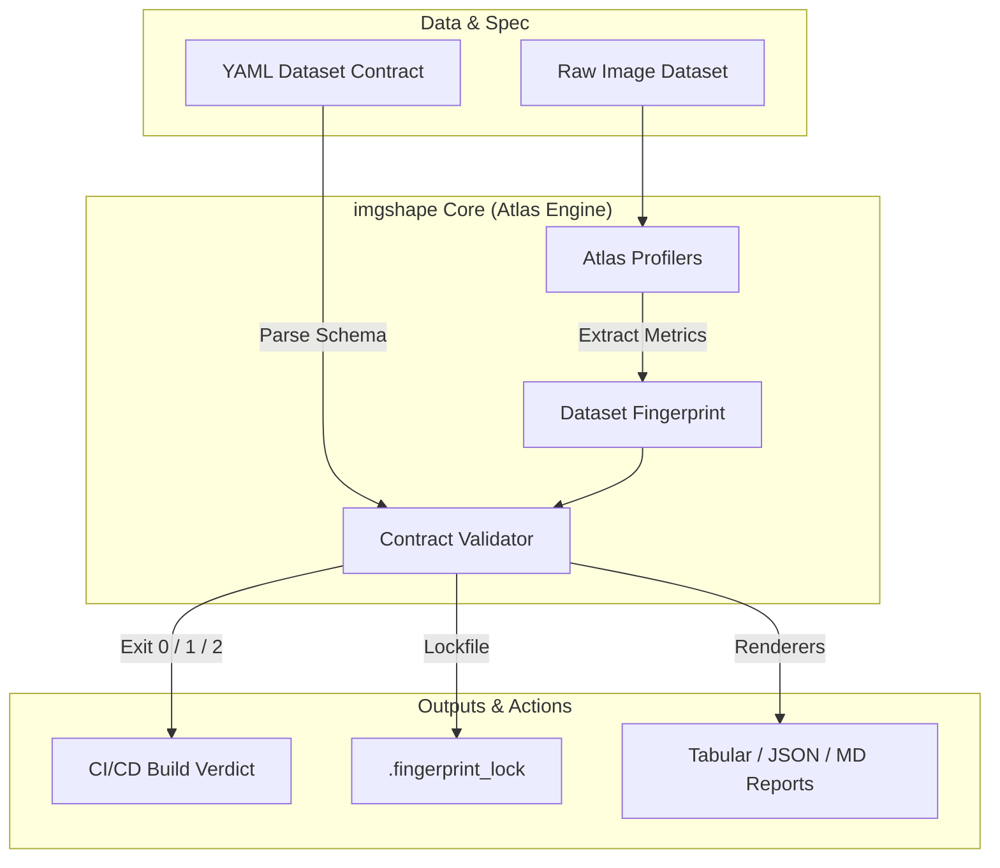

<div align="center">

# 🖼️ imgshape

### Vision Dataset Governance & Contract Enforcement Engine

[](https://github.com/STiFLeR7/imgshape/releases/tag/v5.0.0)
[](https://pypi.org/project/imgshape/)
[](https://pypi.org/project/imgshape/)
[](https://pepy.tech/project/imgshape)

<br/>

> **"Define declarative contracts, run pytest-style assertions on your image datasets, and prevent training regressions in CI/CD."**

<br/>

[**📖 Documentation**](https://github.com/STiFLeR7/imgshape/blob/master/README.md) • [**💬 Report Bug / Discuss**](https://github.com/STiFLeR7/imgshape/discussions)

</div>

---

## ⚡ What is imgshape v5.0.0 "Covenant"?

`imgshape` is a CI/CD-native developer tool and Python library for vision ML dataset governance. It transitions from heuristics to a strict **contract-driven validation framework**. 

By running deterministic audits across **spatial, signal, distribution, quality, and semantic** dimensions, `imgshape` ensures that your training and validation pipelines run on verified, regression-free, and high-fidelity datasets.

### 🔑 Core Features

*   **📄 Declarative Dataset Contracts**: Write YAML schemas enforcing channel configurations, format restrictions, resolution bounds, entropy ranges, and maximum allowed corruption or duplicate rates.
*   **🧪 pytest-style Dataset Testing (`imgshape test`)**: Run automated assertions on image folders with clean, tabular console summaries and markdown/JSON output renderers.
*   **📐 Git-style Dataset Diffing (`imgshape diff`)**: Compare a baseline and candidate dataset to detect statistical shifts, class imbalances, and semantic drift using DINOv2 embeddings.
*   **🔒 Cryptographic Audit Trails**: Generates content-hashed `provenance_id` metadata and writes cross-platform `.fingerprint_lock` lockfiles to track and seal dataset state.
*   **🚀 Ultra-lean & Portable**: 100% Python library with a CLI. No Node.js, React UI, Streamlit, or local web servers. Fits perfectly into GitHub Actions, GitLab CI, or local terminals.

---

## ⚡ Quick Start

### 1. Install imgshape

```bash
# Install core package (minimal dependencies)
pip install imgshape

# Install with PyTorch support for semantic drift & GPU acceleration
pip install "imgshape[full]"
```

### 2. Define a Dataset Contract (`contract.yaml`)

Create a contract file to define the expected boundaries of your dataset:

```yaml
schema_version: "5.0"
dataset:
  expected_channels: 3
  allowed_formats: [png, jpg]
  resolution_min: [224, 224]
  resolution_max: [1024, 1024]
quality:
  blur_threshold: 1.5
  corruption_max: 0.01
  duplicate_max: {value: 0.05, severity: warning}
distribution:
  entropy_min: 3.5
  imbalance_ratio_max: 2.0
```

### 3. Run Validation via CLI

```bash
# Validate dataset against contract (exits with non-zero code on error)
imgshape validate ./my_dataset_directory contract.yaml --lock
```

*The `--lock` flag automatically writes a `.fingerprint_lock` metadata file alongside the contract to secure your dataset version signature.*

### 4. Perform Git-style Dataset Comparison

Compare candidate dataset against baseline fingerprint to verify drift:

```bash
# Compare candidate folder against baseline fingerprint
imgshape diff baseline_fingerprint.json ./new_candidate_dataset/ --save diff_report.md
```

---

## 🐍 Python API Usage

You can embed contract governance directly into your training scripts or data preparation notebooks:

```python
from pathlib import Path
from imgshape.atlas import Atlas
from imgshape.contract import ContractLoader, ContractValidator

# 1. Profile the dataset
atlas = Atlas()
fingerprint = atlas.extract(Path("./my_dataset"))

# 2. Load the contract
contract = ContractLoader.load_yaml(Path("contract.yaml"))

# 3. Validate
validator = ContractValidator(contract)
report = validator.validate(fingerprint)

if report.passed:
    print(f"✅ Dataset validated successfully! Provenance ID: {report.provenance_id}")
else:
    print("❌ Dataset contract validation failed:")
    for violation in report.violations:
        print(f" - [{violation.severity.upper()}] {violation.clause}: {violation.message}")
```

---

## 🏗️ Architecture & Flow

`imgshape` operates as a strict quality gate between your data storage layers and model training environments.



---

## 📦 Dependency Groups

| Group | Command | Use Case |
| :--- | :--- | :--- |
| **Core** | `pip install imgshape` | Lightweight CI/CD verification & basic profiling (~10MB) |
| **Torch** | `pip install "imgshape[torch]"` | Adds PyTorch-based GPU acceleration & semantic feature extraction |
| **Full** | `pip install "imgshape[full]"` | Standard installation containing PDF reports, Plotly viz, and Torch extras |

---

## 🤝 Community & Support

*   **Issues**: Encountered a bug? [Open an issue](https://github.com/STiFLeR7/imgshape/issues).
*   **Discussions**: Share ideas and workflows? [Join the discussion](https://github.com/STiFLeR7/imgshape/discussions).

<div align="center">

*Built by [Stifler](https://github.com/STiFLeR7) for the ML and AI Engineering community.*

**[Star on GitHub](https://github.com/STiFLeR7/imgshape) ⭐**

</div>
